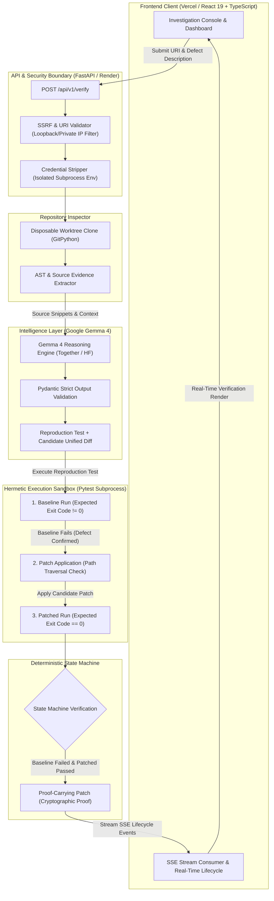

# Inevitable

**"Don't trust the patch. Prove it."**

Inevitable is an open-source, AI-powered software verification agent that generates **Proof-Carrying Patches**. Instead of trusting Large Language Models to write correct code on faith, Inevitable rigorously executes AI-generated candidate patches against reproducible test baselines in a secure sandboxed environment. If a patch cannot prove it fixes the defect without regressing the system, it is rejected. 

Built for the **Hacktoberfest Hackathon**, Inevitable demonstrates a paradigm shift in AI coding: verifiable trust.

---

## The Problem and Our Solution

**The Problem**: AI coding assistants (like GitHub Copilot or ChatGPT) generate plausible-looking patches for bugs. However, developers are often forced to blindly trust the AI's logic, leading to subtle regressions, hallucinations, and broken builds.
**The Solution**: Inevitable reverses this dynamic. When you describe a bug and point to a repository, Inevitable's backend intelligence (powered by Google's Gemma 4) doesn't just guess a fix. It isolates the fault, writes a deterministic reproduction test, generates a candidate patch, and then *proves* the fix by executing both the baseline and patched code in a strictly isolated environment. 

Every successful run produces a **Proof-Carrying Patch**—a cryptographically verifiable report containing the source evidence, the executed tests, the deterministic state machine evaluation, and the exact diff.

## Why Proof-Carrying Patches Matter

- **Zero Trust AI**: We treat the LLM as an untrusted actor. Its reasoning is entirely discarded if the deterministic test harness proves it wrong.
- **Explainability**: You receive a comprehensive report of exactly which lines were changed and the standard outputs of the execution before and after.
- **Safety**: Unverified AI code never reaches your `main` branch.

---

## Architecture & Technology Stack

Inevitable is designed as a zero-trust, decoupled verification system that separates generative AI reasoning from deterministic execution:

### System Architecture Diagram



### Backend (Python)
- **FastAPI**: Asynchronous, high-performance API routing with Server-Sent Events.
- **Pydantic**: Strict data validation for all LLM outputs to prevent malformed schema attacks.
- **GitPython**: Safely fetches and isolates target repositories into disposable worktrees.
- **Pytest**: The deterministic execution engine for validating regression tests and patches.
- **Gemma 4 (Together AI / Hugging Face)**: Intelligence layer for root-cause analysis and patch generation.

### Frontend (TypeScript)
- **React + Vite**: A lightning-fast, highly responsive single-page application.
- **Server-Sent Events (SSE)**: Provides real-time lifecycle tracking directly from the backend execution engine without polling.
- **Vanilla CSS**: A strict, lightweight, dependency-free styling system built on a custom "Midnight Slate" and "Azure Accent" aesthetic.

---

## Installation and Configuration

### Prerequisites
- Python 3.11+
- Node.js 20+
- Git

### 1. Clone the repository
```bash
git clone https://github.com/desireddymohithreddy0925/Inevitable.git
cd Inevitable
```

### 2. Backend Setup
```bash
cd backend
python -m venv venv
source venv/bin/activate
pip install -r requirements.txt

# Configure the environment
cp .env.example .env
# Open .env and add your TOGETHER_API_KEY if you want to use the live Gemma 4 model
```

### 3. Frontend Setup
```bash
cd ../frontend
npm install
cp .env.example .env
```

---

## Real Demo Workflow

You can spin up the full stack using Docker Compose:
```bash
docker compose up --build
```
Navigate to `http://localhost:5173`. 

**To safely evaluate the agent without risking executing untrusted code on your host system:**
1. Leave the backend `.env` configuration as `ENABLE_UNTRUSTED_EXECUTION=false`.
2. In the frontend dashboard, enter `demo:local-fixture` as the Repository URL.
3. Click "Run Proof-Carrying Verification".
4. Watch the real-time SSE event pipeline as it clones the fixture, analyzes the AST, invokes the Mock/Gemma provider, and executes the Python subprocesses.
5. Review the resulting **Proof-Carrying Patch** report and download the cryptographic JSON.

---

## Security Boundaries and Limitations

Inevitable executes arbitrary code. We take this extremely seriously.

- **SSRF Prevention**: The URL inspection engine explicitly resolves and drops private, link-local, and loopback IPs.
- **Environment Isolation**: Subprocesses are strictly stripped of all host environment variables (including API keys) before untrusted tests run.
- **Path Traversal Protection**: Unified diffs are rigidly validated to block `../` and absolute paths before `git apply` is invoked.
- **Execution Sandboxing**: By default, `ENABLE_UNTRUSTED_EXECUTION` is `false`. Attempting to run untrusted URLs will instantly return a `BLOCKED` state machine status. We do not employ `cgroups` or unprivileged Docker namespaces natively in the Python engine, so deploying this publicly with untrusted execution enabled is **strictly prohibited**.

---

## Contribution Instructions

We welcome contributions! Please follow these steps:
1. Fork the repository.
2. Create a feature branch (`git checkout -b feature/amazing-feature`).
3. Ensure backend tests pass (`cd backend && pytest tests/`).
4. Ensure frontend builds cleanly (`cd frontend && npm run build`).
5. Submit a pull request detailing the changes and verifying security constraints.

## Roadmap

- **Phase 1-12**: Complete (Monorepo, Gemma 4 Integration, Pytest Runner, React UI, Security Hardening).
- **Future Work**: 
  - Add native Docker-in-Docker (dind) isolation for safe, public, arbitrary execution.
  - Expand execution harnesses beyond `pytest` (e.g., `jest`, `cargo test`).
  - Introduce GitHub App integration for automated PR verification.

---
*Inevitable is licensed under the Apache 2.0 License.*
